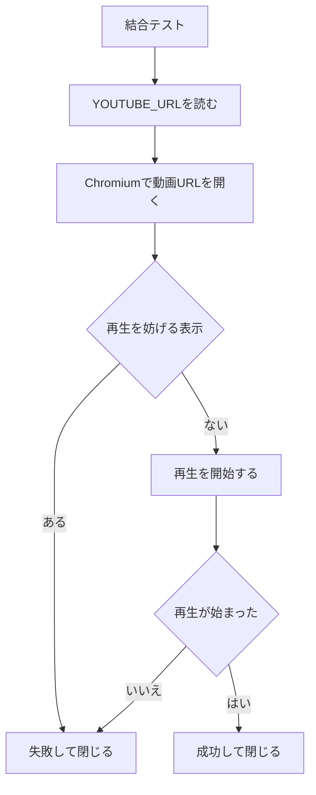

# 設計

要件の正本は [requirements.md](requirements.md) です。この文書は、その初版の動作を定めます。

## 初版の範囲

1本の動画 URL を、ログインせずに開いて再生を開始する。完了は、その動画の再生が始まったことである。テストが終わるとブラウザは閉じる。再生を続けたままにするモードは初版に含めない。

初版に含めないものは次のとおり。

- 再生リストと検索キーワード
- Google アカウントへのログイン、クッキー、`storageState`
- 指定秒数の再生、最後までの再生、次の動画への移動
- 同意ボタンや広告のスキップを自動で押すこと
- 再生回数や評価を増やすための操作

## 入力

動画 URL は、プロジェクト直下の `.env` に環境変数 `YOUTUBE_URL` として書く。このファイルはコミットしない。変数名だけの見本は [`.env.example`](../.env.example) である。`playwright.config.ts` が `.env` を読み、結合テストは `YOUTUBE_URL` を参照する。

受け付ける URL は、`https://www.youtube.com/watch?v=` で始まるもの、または `https://youtu.be/` で始まるもの。それ以外は失敗とする。

## 処理の流れ

使用ブラウザは Chromium。ウィンドウは既定では出さない。見るときは `npx playwright test --headed` を使う。`package.json` の `test` に `--headed` は常設しない。



再生を妨げる表示とは、同意ダイアログ、年齢確認、本編の開始を妨げる広告、再生できない旨の表示である。これらを自動でクリックして先へ進むことはしない。

## 成功と失敗

成功は、指定した動画の再生が始まったこと。再生位置が進んでいることで判断する。成功後にブラウザは閉じる。

失敗は次のいずれか。

- `YOUTUBE_URL` が無い、または受け付ける URL ではない
- 同意ダイアログ、年齢確認、広告のいずれかが本編の再生開始を妨げている
- 動画が削除されている、非公開である、その他の理由で再生できない
- 再生を開始しても、再生位置が進まない

失敗したときもブラウザは閉じる。ログインへ切り替えて再試行しない。

## テスト

ソースを追加または変更するときは、同じ変更で単体テストと結合テストを追加または更新する。ブラウザを使わない判定は単体テスト、YouTube を開く操作は結合テストに書く。

- 単体テストは `tests/unit/**/*.test.ts`。Node.js のテストランナーで実行する。
- 結合テストは `tests/integration/**/*.spec.ts`。Playwright で Chromium を操作する。
- `npm test` は、先に `src` の有無を確認する。ソースが無いときはテスト 0 件で成功する。ソースがあるときは、単体テストと結合テストのファイルが両方必要で、そのあと単体テスト、結合テストの順に実行する。
- `push` と pull request では、GitHub Actions が `npm test` を実行する。結合テスト用の `YOUTUBE_URL` はリポジトリの Secrets に置く。

## ファイルの置き場所

```text
docs/requirements.md            要件
docs/design.md                  この設計
.env                            YOUTUBE_URL を書く。コミットしない
.env.example                    変数名だけの見本
src/                            再生のソース。実装時に追加する
tests/unit/**/*.test.ts         単体テスト。ソースと同時に追加する
tests/integration/**/*.spec.ts  結合テスト。ソースと同時に追加する
scripts/check-test-files.cjs    src があるとき、両方のテストファイルを要求する
playwright.config.ts            .env の読み込みと、Chromium だけを使う設定
.github/workflows/test.yml      push と pull request で npm test を実行する
```
